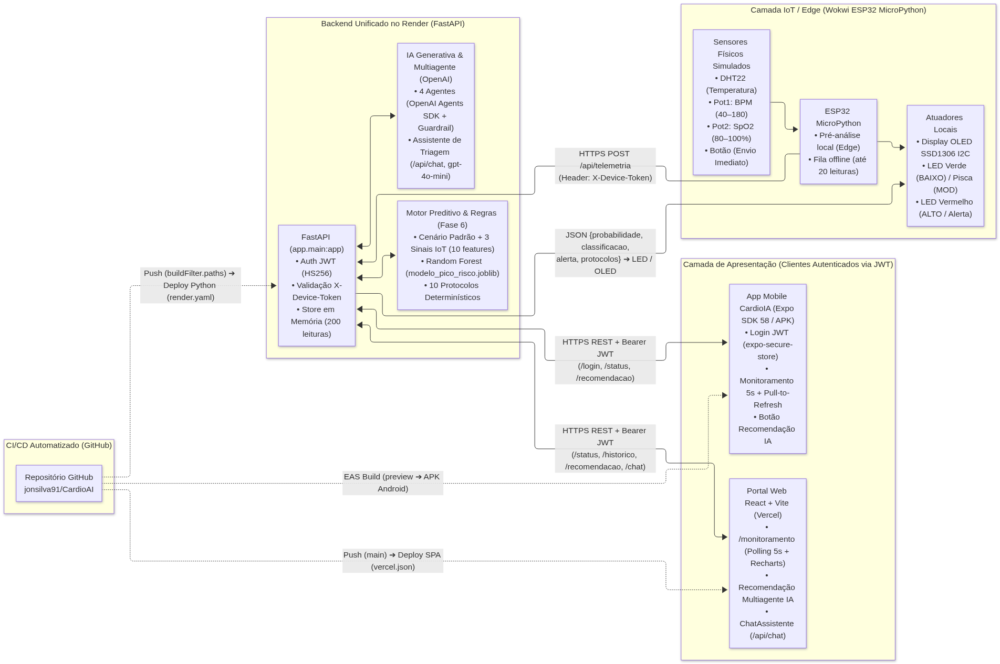

# Relatório Técnico — Fase 7: Plataforma Integrada CardioAI (IoT, Cloud, ML, Multiagente, Web e Mobile)

**Instituição:** FIAP — Faculdade de Informática e Administração Paulista  
**Integrantes:** Jonas Luis da Silva (RM561465) e Edson Henrique Felix Batista (RM566321)  
**Repositório:** `https://github.com/jonsilva91/CardioAI` (`phases/fase07_plataforma_integrada/`)

---

## Links Oficiais em Produção

- **Portal Web (Vercel):** [https://cardio-ai-five.vercel.app](https://cardio-ai-five.vercel.app)
- **Backend Unificado (Render):** [https://cardioai-fase07-backend.onrender.com](https://cardioai-fase07-backend.onrender.com) ([/docs](https://cardioai-fase07-backend.onrender.com/docs) | [/health](https://cardioai-fase07-backend.onrender.com/health))
- **Build APK Android (Expo EAS):** [https://expo.dev/accounts/jonsilva91/projects/mobile-cardioia/builds/be64508a-ebc2-4fb2-9ab3-93a89bb8b267](https://expo.dev/accounts/jonsilva91/projects/mobile-cardioia/builds/be64508a-ebc2-4fb2-9ab3-93a89bb8b267)
- **Simulação IoT ESP32 MicroPython (Wokwi):** [https://wokwi.com/projects/480500031706588161](https://wokwi.com/projects/480500031706588161)
- **Credenciais de Demonstração (Dados Sintéticos):** `demo@cardioia.com` / `CardioIA@2026` (Paciente padrão: `PAC-001`)

---

## 1. Objetivo

A Fase 7 consolida os subsistemas desenvolvidos ao longo do projeto **CardioAI** em uma **plataforma integrada de ponta a ponta em nuvem**, conectando em tempo real a camada de borda IoT (**ESP32 em MicroPython no Wokwi**), um **Backend FastAPI no Render**, o **Modelo Preditivo Random Forest**, o **Motor Determinístico de Protocolos** e o **Sistema Multiagente (`OpenAI Agents SDK`) da Fase 6**, um **Assistente Conversacional de Triagem (`gpt-4o-mini`)**, o **Portal Web React/Vite na Vercel** e o **Aplicativo Mobile React Native/Expo (APK Android via EAS Build)**.

---

## 2. Diagrama de Arquitetura Final

---

## 3. Fluxo dos Dados Ponta a Ponta

1. **Coleta e Pré-Análise na Borda (Wokwi ESP32 MicroPython):** A cada **5 segundos** (ou instantaneamente ao pressionar o botão físico no `GPIO 15`), o firmware lê a temperatura no sensor `DHT22` (`GPIO 4`), a frequência cardíaca (`BPM`, 40–180) no potenciômetro 1 (`GPIO 34`) e a saturação periférica de oxigênio (`SpO2`, 80–100%) no potenciômetro 2 (`GPIO 35`). Antes do envio à nuvem, executa uma pré-análise local (`BPM > 120`, `SpO2 < 92`, `temperatura > 38 °C`) e atualiza o display **OLED SSD1306 I2C**.
2. **Ingestão Segura (`POST /api/telemetria`):** O ESP32 envia o JSON `{device_id, paciente_id: "PAC-001", fc_media, temperatura, spo2_media}` via HTTPS com o cabeçalho `X-Device-Token`.
3. **Inferência Preditiva e Regras Clínicas (Integração Direta com a Fase 6):** O backend resolve dinamicamente o caminho de `phases/fase06_preditivo_multiagente` no `sys.path` e importa `src.predictor`, `src.protocols` e `src.agents_system` sem duplicação de código. As 3 variáveis do sensor são combinadas ao **Cenário Hospitalar Padrão** (`CENARIO_PADRAO`), compondo as 10 features exigidas pelo modelo `modelo_pico_risco.joblib` (Random Forest, 99,9% de acurácia). Em seguida, `consultar_protocolos` avalia deterministicamente as 10 diretrizes hospitalares.
4. **Feedback Visual no Dispositivo IoT:** O backend responde `{probabilidade, classificacao, alerta, protocolos}` ao ESP32, que exibe `"Risco 0.xx ALTO"` no OLED e aciona os LEDs: **vermelho** (`GPIO 5`) para risco `ALTO` ou alerta ativo, **verde** (`GPIO 2`) para `BAIXO`, e **pisca** para `MODERADO`.
5. **Consumo Web e Mobile Autenticado (JWT):** O Portal React (Vercel) e o App Mobile (APK Android) autenticam-se em `POST /api/auth/login`, recebem um token JWT (`HS256`) e consultam `GET /api/pacientes/PAC-001/status` e `/historico?limite=50` a cada **5 segundos**, exibindo cards vitais, série histórica e protocolos.
6. **IA Generativa Sob Demanda (`/recomendacao` e `/api/chat`):** Quando acionado pelo profissional de saúde, `POST /api/pacientes/PAC-001/recomendacao` executa o pipeline real de **4 agentes** da Fase 6 (Orquestrador ➔ Analista de Risco ➔ Especialista em Protocolos ➔ Planejador de Resposta com *Output Guardrail*). O endpoint `POST /api/chat` disponibiliza o assistente cardiológico de triagem com memória em sessão e aviso fixo `"Não substitui avaliação médica."`.

---

## 4. Decisões Arquiteturais

- **HTTP REST (`urequests`) em vez de MQTT:** Na Fase 3 utilizou-se MQTT (`broker.hivemq.com`). Na Fase 7 optou-se por `HTTPS POST /api/telemetria` direto ao backend FastAPI porque o protocolo HTTP permite retorno síncrono imediato da inferência de Machine Learning (`probabilidade`, `classificacao`, `alerta`) na própria resposta da requisição, comandando os LEDs e o display OLED do ESP32 sem depender de um broker intermediário externo.
- **Polling de 5 s nos Clientes:** Alinhado exatamente ao intervalo de amostragem do ESP32 (5 s), garantindo atualização contínua ("Ao vivo / atualizado há X s") com simplicidade operacional e tolerância a reconexões em planos gratuitos de nuvem.
- **Execução de LLM e Multiagente Apenas Sob Demanda (Controle de Custos e Latência):** O cálculo de risco a cada 5 s executa exclusivamente o Random Forest (`~12 µs`) e o motor de regras determinístico, sem custo de tokens. O pipeline multiagente e o LLM (`gpt-4o-mini`) só são invocados mediante ação explícita do usuário e contam com *rate-limit* de **1 chamada a cada 30 s** por paciente (`HTTP 429`).
- **Sensores IoT + Cenário Padrão ➔ 10 Features do Modelo:** Como o dispositivo vestível/beira-leito mede 3 sinais vitais (`fc_media`, `temperatura`, `spo2_media`), o backend completa as 7 variáveis contextuais da unidade (`idade_media=62`, `carga_sistema=60`, `tempo_espera=40`, `pa_sistolica=120`, `densidade_eventos=3`, `eventos_24h=2`, `disponibilidade_recursos=60`), preservando o contrato exato das 10 features da Fase 6.
- **Edge Computing com Pré-Análise Local e Fila Offline:** Garante que alertas críticos (`BPM > 120`, `SpO2 < 92`, `temp > 38 °C`) sejam sinalizados imediatamente na borda mesmo durante o *cold start* da nuvem.

---

## 5. Deploy e CI/CD

- **Portal Web na Vercel (`apps/portal-cardioia/vercel.json`):** Integrado ao GitHub com deploy contínuo a cada *push*. O arquivo `vercel.json` configura o rewrite SPA (`/(.*) -> /index.html`) e consome `VITE_API_URL`.
- **Backend no Render (`render.yaml` na raiz):** Configurado como Web Service Python no plano `free`, com `healthCheckPath: /health` e `buildFilter.paths` restrito a `phases/fase07_plataforma_integrada/backend/**`, `phases/fase06_preditivo_multiagente/src/**`, `phases/fase06_preditivo_multiagente/models/**` e `render.yaml`, evitando rebuilds desnecessários quando apenas front-end ou documentação são alterados.
- **App Mobile no Expo EAS Build (`apps/mobile-cardioia/eas.json`):** Migrado do SDK 49 para o **Expo SDK 58** (`20/20 checks passed` no `npx expo-doctor`), pacote Android `br.com.fiap.cardioia` (`versionCode: 1`), sem permissões invasivas de câmera/armazenamento, e perfil `preview` configurado com `android.buildType: "apk"` e `EXPO_PUBLIC_API_URL`.

---

## 6. Segurança, Privacidade e Conformidade (LGPD)

- **Segredos Estritamente em Variáveis de Ambiente:** `JWT_SECRET`, `DEVICE_TOKEN`, `DEMO_EMAIL`, `DEMO_PASSWORD` e `OPENAI_API_KEY` nunca constam no código. O backend valida as variáveis obrigatórias no startup (`validar_configuracao_obrigatoria()`) e falha imediatamente caso alguma esteja ausente. O endpoint `/health` expõe apenas um booleano (`openai_api_key: true/false`), nunca o valor da chave.
- **Autenticação em Dupla Camada:** Dispositivos IoT autenticam-se via `X-Device-Token` (comparação em tempo constante com `hmac.compare_digest`), enquanto clientes web e mobile utilizam `Authorization: Bearer <JWT>` (persistido com criptografia nativa via `expo-secure-store` no Android).
- **CORS Restrito e Dados Sintéticos:** O middleware CORS aceita apenas as origens listadas em `ALLOWED_ORIGINS`. Todo o tráfego utiliza identificadores anônimos e dados sintéticos (`PAC-001`), acompanhados do aviso ético obrigatório `"Não substitui avaliação médica."`.

---

## 7. Conversão C++ (Fase 3) ➔ MicroPython (Fase 7)

| Funcionalidade | Fase 3 — C++ (`sketch.ino`) | Fase 7 — MicroPython (`iot/main.py`) |
| :--- | :--- | :--- |
| **Transporte de Rede** | `PubSubClient` / MQTT (`mqtt.publish`) | `urequests.post` / HTTPS REST (`X-Device-Token`) |
| **Sensor de Temperatura** | `#include <DHT.h>` / `dht.readTemperature()` | `import dht` / `dht.DHT22(Pin(4)).temperature()` |
| **Conversão Analógica (ADC)** | `analogRead(34)` + `map(...)` | `ADC(Pin(34)).read()` + `mapear_adc(...)` (BPM e SpO2) |
| **Controle Digital (LEDs/Botão)** | `digitalWrite` / `digitalRead` | `Pin.value(1/0)` / `Pin(15, Pin.IN, Pin.PULL_UP)` |
| **Interface Local de Borda** | Apenas Serial CSV (`Serial.printf`) | Display **OLED SSD1306 I2C** (`ssd1306.py`) + LEDs Verde/Vermelho |

---

## 8. Resultados Observados em Produção

Os testes integrados entre o simulador Wokwi, o backend no Render, o Portal na Vercel e o APK Android comprovaram a sensibilidade clínica do modelo Random Forest combinado ao motor de protocolos:

| Cenário Testado no Wokwi (`PAC-001`) | Sinais Enviados (`BPM`, `SpO2`, `Temp`) | Probabilidade e Classificação | Protocolos Acionados e Resposta de Borda |
| :--- | :---: | :---: | :--- |
| **1. Taquicardia Isolada com SpO2 Normal** | `BPM = 180` `SpO2 = 100%` `Temp = 36.6 °C` | **0.18 (18%)** **`BAIXO`** (`alerta: true`) | Aciona 1 protocolo individual (`Se FC > 120 → iniciar monitoramento intensivo`). Como a saturação está em 100% e o cenário hospitalar é moderado, a probabilidade de pico sistêmico permanece em 18% (`BAIXO`), mas o alerta de FC ativa vigilância. |
| **2. Descompensação Crítica Combinada** | `BPM = 180` `SpO2 = 80%` `Temp = 36.6 °C` | **0.86 (86%)** **`ALTO`** (`alerta: true`) | Aciona **3 protocolos**: (1) `Se SPO2 < 88% → iniciar suporte respiratório imediato`; (2) `Se FC > 120 → iniciar monitoramento intensivo`; (3) `Se risco sistêmico alto → ativar estado de emergência`. OLED exibe `Risco 0.86 ALTO` e LED vermelho acende. |
| **3. Paciente Basal Estável** | `BPM = 75` `SpO2 = 98%` `Temp = 36.5 °C` | **0.00 (0%)** **`BAIXO`** (`alerta: false`) | **0 protocolos acionados**. OLED exibe `Risco 0.00 BAIXO` e LED verde permanece aceso. |

---

## 9. Limitações Conhecidas

1. **Cold Start no Plano Free do Render (~50 s):** O serviço hiberna após 15 minutos sem tráfego. Mitigado com o banner `"⏳ Servidor acordando, aguarde..."` no portal web e pela fila local no ESP32.
2. **Armazenamento em Memória (`InMemoryStore`):** Limitado às últimas 200 leituras por paciente (`deque(maxlen=200)`), sendo reiniciado em caso de redeploy ou hibernação do container.
3. **Oscilações TLS no Wokwi:** O túnel virtual `Wokwi-GUEST` pode sofrer timeouts ocasionais de handshake HTTPS; o firmware trata a falha enfileirando até 20 leituras localmente e reenviando no próximo ciclo.
4. **CNN de ECG da Fase 4 Fora do Deploy Unificado:** O TensorFlow foi excluído do `requirements.txt` da Fase 7 para respeitar o limite de 512 MB de RAM do plano gratuito do Render.
5. **Dados Sintéticos e Validação Mobile em Emulador:** Todos os dados são sintéticos. A validação funcional do APK foi realizada no emulador **Android Pixel 7 (Android 13) via Appetize.io**, pois o integrante utiliza iOS, complementada pela verificação de build no Expo EAS.

---

## 10. Próximos Passos

- Substituir o `InMemoryStore` por persistência distribuída em **PostgreSQL / TimescaleDB** e controle de *rate-limit* em **Redis**;
- Implementar streaming bidirecional via **WebSockets / Server-Sent Events (SSE)** para eliminar o polling de 5 s;
- Portar o modelo CNN de ECG da Fase 4 para **ONNX Runtime** (leve em memória) para unificar a análise de imagem no mesmo backend;
- Acoplar sensores biomédicos físicos reais (**MAX30102** para oximetria/FC e **DS18B20** para temperatura) em bancada ESP32.
