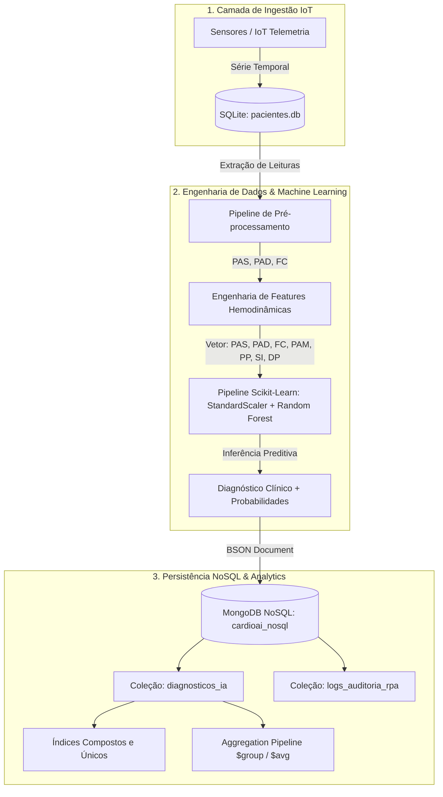

# IR ALÉM 2 - Pipeline de Monitoramento Inteligente: IA Preditiva e Persistência NoSQL (MongoDB)

**CardioAI - Fase 5: Assistente Conversacional e RPA Avançado**  
**Papel Técnico:** Engenheiro de Dados e Machine Learning  
**Data:** Outubro de 2026  

---

## 1. Visão Geral da Refatoração

A versão inicial do desafio **Ir Além 2** utilizava limiares fixos (*hardcoded if/else*) e persistência em um arquivo JSON local estático (`logs_alertas.json`). Embora funcional para uma demonstração preliminar, essa abordagem apresentava severas limitações de escalabilidade, manutenibilidade clínica e rigor analítico.

Nesta refatoração de nível de produção:
1. **Substituição dos Limiares Fixos por Machine Learning Real:** Implementamos um classificador Supervisionado baseado em **Random Forest (`RandomForestClassifier`)** com **Engenharia de Features Hemodinâmicas Clínicas**, estimativa probabilística de risco e serialização (`joblib`).
2. **Substituição do Arquivo JSON por Banco NoSQL Real (MongoDB / MongoDB Atlas):** Implementamos persistência direta via **`pymongo`**, suporte ao MongoDB Atlas em nuvem ou MongoDB local via Docker, criação automática de índices compostos, consultas analíticas e agregação via **MongoDB Aggregation Pipeline**.

---

## 2. Arquitetura de Dados Híbrida (Relacional + NoSQL)



### 2.1. Papel dos Bancos de Dados
* **Banco Relacional (SQLite - `pacientes.db`):** Atua como o repositório de telemetria bruta e séries temporais de sensores (tabela `leituras_sensores`), ideal para ingestão sequencial de alta frequência e ordenação temporal.
* **Banco Não-Relacional (MongoDB - `cardioai_nosql`):** Repositório *document-oriented* para armazenamento dos diagnósticos preditos, distribuições de probabilidades, listas heterogêneas de anomalias e metadados de auditoria clínica.

---

## 3. Modelo de Machine Learning e Engenharia de Features

### 3.1. Features Hemodinâmicas Calculadas
Em vez de analisar apenas os valores isolados de pressão e frequência cardíaca, o pipeline calcula marcadores clínicos estabelecidos pela Sociedade Brasileira de Cardiologia (SBC):

| Feature | Fórmula | Significado Clínico |
| :--- | :--- | :--- |
| **PAS** | Pressão Sistólica | Pressão máxima durante a sístole ventricular |
| **PAD** | Pressão Diastólica | Pressão mínima durante a diástole ventricular |
| **FC** | Frequência Cardíaca | Batimentos por minuto (bpm) |
| **PAM** | $(PAS + 2 \times PAD) / 3$ | **Pressão Arterial Média:** Perfusão tecidual orgânica |
| **PP** | $PAS - PAD$ | **Pressão de Pulso:** Marcador de rigidez arterial e complacência |
| **SI** | $FC / PAS$ | **Índice de Choque:** Indicador precoce de choque cardiogênico ou sepse |
| **DP** | $(PAS \times FC) / 100$ | **Duplo Produto:** Consumo de oxigênio miocárdico e sobrecarga |

### 3.2. Estratificação de Risco (Classes Clínicas)
O classificador prediz 4 estratos de risco clínico:
* **`0: BAIXO_RISCO`:** Normotensão ($110-125/70-80\text{ mmHg}$) e FC fisiológica ($60-85\text{ bpm}$).
* **`1: RISCO_MODERADO`:** Pré-hipertensão ($130-139/85-89\text{ mmHg}$) ou taqui/bradicardia leve.
* **`2: ALTO_RISCO`:** Hipertensão Estágio 2 ($160-179/100-109\text{ mmHg}$) ou arritmias moderadas.
* **`3: RISCO_CRITICO`:** Crise Hipertensiva ($PAS \ge 180$ ou $PAD \ge 110\text{ mmHg}$), Taquiarritmia Grave ($FC \ge 130\text{ bpm}$) ou Colapso Hemodinâmico ($PAS \le 85\text{ mmHg}$).

### 3.3. Performance do Modelo
Treinado com validação estratificada (estratificação cruzada 75% treino / 25% teste), balanceamento de classes (`class_weight='balanced'`) e normalização com `StandardScaler`:
* **Acurácia Global de Teste:** **97.00%**
* **F1-Score por Classe:**
  * `BAIXO_RISCO`: **0.96**
  * `RISCO_MODERADO`: **0.95**
  * `ALTO_RISCO`: **0.98**
  * `RISCO_CRITICO`: **0.99**

O pipeline treinado é serializado em disco como [`modelo_risco.joblib`](modelo_risco.joblib) para inferências imediatas em microssegundos.

### 3.4. Limitações Metodológicas do Modelo (Transparência Acadêmica)
Um aspecto crítico de governança e ética em IA médica consiste em reconhecer as limitações metodológicas do pipeline preditivo:
1. **Dados Sintéticos Rotulados por Regras Clínicas:** Devido a restrições éticas e de privacidade sobre prontuários hospitalares reais nesta etapa de desenvolvimento, o modelo foi treinado em uma base sintética gerada por distribuições estatísticas gaussianas calibradas segundo as Diretrizes da SBC/SBH. Os rótulos de risco supervisionados foram atribuídos a partir de regras clínicas determinísticas.
2. **Impacto na Generalização:** Embora o Random Forest aprenda fronteiras de decisão contínuas multivariadas, capture interações complexas entre marcadores hemodinâmicos e produza probabilidades calibradas (muito superior a árvores estáticas de `if/else`), o modelo reflete primariamente os limiares codificados na síntese. Ele não internaliza ruídos de artefatos de medição ambulatorial, comorbidades raras não modeladas ou padrões atípicos de pacientes graves.
3. **Caminho para Produção:** Em um desdobramento hospitalar real, é mandatório realizar *transfer learning* ou retreinamento supervisionado com prontuários eletrônicos reais desidentificados (como bases MIMIC-IV ou PhysioNet), sob aprovação de Comitê de Ética em Pesquisa (CEP/CONEP).

---

## 4. Integração NoSQL com MongoDB Real

### 4.1. Configuração e Variáveis de Ambiente
O arquivo [`mongodb_config.json`](mongodb_config.json) define os parâmetros operacionais, sobrescrevíveis por variáveis de ambiente no `.env`:
* `MONGO_URI`: URI de conexão (ex.: `mongodb://localhost:27017` ou `mongodb+srv://...` no MongoDB Atlas).
* `MONGO_DATABASE`: Nome da base (`cardioai_nosql`).
* `MONGO_TIMEOUT_MS`: Timeout de conexão (2500 ms).

### 4.2. Estrutura do Documento NoSQL BSON
Cada predição gera um documento JSON/BSON rico e auto-contido:
```json
{
  "id_diagnostico": "DIAG-ML-1792009147620-102",
  "paciente_id": 102,
  "timestamp_inferencia": "2026-10-14T17:19:07.620222",
  "origem_leitura": {
    "fonte": "SQLite (Sensor IoT)",
    "id_leitura_relacional": 2,
    "timestamp_leitura": "2026-10-14T17:19:04"
  },
  "telemetria": {
    "pressao_sistolica": 195,
    "pressao_diastolica": 115,
    "frequencia_cardiaca": 128,
    "pressao_arterial_media": 141.67,
    "pressao_pulso": 80.0,
    "indice_choque": 0.656,
    "duplo_produto": 249.6
  },
  "predicao": {
    "modelo_versao": "RandomForest-v2.1",
    "risco_nivel": "RISCO_CRITICO",
    "classe_id": 3,
    "confianca": 1.0,
    "alerta_critico": true,
    "distribuicao_probabilidades": {
      "BAIXO_RISCO": 0.0,
      "RISCO_MODERADO": 0.0,
      "ALTO_RISCO": 0.0,
      "RISCO_CRITICO": 1.0
    },
    "anomalias_detectadas": [
      "Crise Hipertensiva (PA: 195/115 mmHg)",
      "Taquicardia Sinusal (FC: 128 bpm)"
    ],
    "recomendacao_clinica": "EMERGENCIA CARDIOLOGICA: Protocolo de crise hipertensiva/arritmia acionado. Avaliacao medica de urgencia requerida!"
  },
  "metadados_governanca": {
    "autor_pipeline": "Engenharia de Dados & ML CardioAI",
    "framework": "Scikit-Learn + PyMongo",
    "conformidade": "Diretrizes SBC / SBH"
  }
}
```

### 4.3. Índices de Alta Performance
O gerenciador cria automaticamente índices no MongoDB:
1. `{"paciente_id": 1, "timestamp_inferencia": -1}`: Acelera consultas cronológicas do prontuário.
2. `{"predicao.risco_nivel": 1}`: Indexação para painéis de triagem por gravidade.
3. `{"predicao.alerta_critico": 1}`: Indexação booleana rápida para acionamento de sirenes/notificações da UTI.
4. `{"id_diagnostico": 1}`: Chave única de integridade referencial.

### 4.4. Consultas e Agregações Implementadas
A classe `NoSQLManager` implementa métodos diretos:
* `inserir_diagnostico(diagnostico_dict)`
* `consultar_historico_paciente(paciente_id, limite=5)`
* `consultar_alertas_criticos(limite=5)`
* `obter_estatisticas_risco()` via MongoDB Aggregation:
```javascript
db.diagnosticos_ia.aggregate([
  {
    $group: {
      _id: "$predicao.risco_nivel",
      total: { $sum: 1 },
      confianca_media: { $avg: "$predicao.confianca" }
    }
  }
])
```

---

## 5. Como Executar

### 5.1. Subindo o MongoDB com Docker (Opcional)
Se desejar rodar o MongoDB localmente em container:
```bash
docker compose -f phases/fase05_assistente_conversacional/ir_alem_2_rpa_dados_hibridos/docker-compose.nosql.yml up -d
```
> O Mongo Express estará disponível em `http://localhost:8081` para visualização web da base.

### 5.2. Executando o Pipeline
Com o ambiente virtual ativado:
```bash
cd phases/fase05_assistente_conversacional/ir_alem_2_rpa_dados_hibridos
..\.venv\Scripts\python.exe robo_monitoramento.py
```

---

## 6. Conclusão e Governança Clínica
A refatoração eleva o desafio **Ir Além 2** ao padrão corporativo da indústria de saúde (*HealthTech*):
1. **Inteligência Real:** Elimina limiares manuais simplistas, incorporando correlações não-lineares multivariadas entre pressão arterial e frequência cardíaca.
2. **Data Lineage:** Cada documento NoSQL preserva a telemetria bruta original, os cálculos intermediários, a versão do algoritmo de IA e o grau de certeza preditiva, garantindo conformidade com a LGPD e normativas do CFM/SBC.
