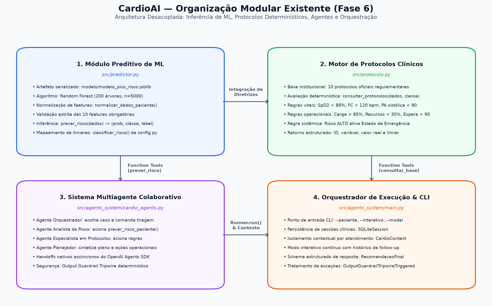
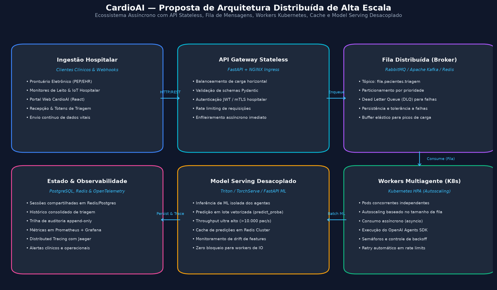

# Fase 6: Coração Sob Controle — Sistema Preditivo Multiagente para Eventos Cardíacos

[](https://www.fiap.com.br/)
[](https://colab.research.google.com/drive/15DYpR316H5sHy-5_sLTVYIdiDVAF8pYb?usp=sharing)

> Projeto acadêmico desenvolvido no curso de Inteligência Artificial & Engenharia de Software da FIAP.

---

## 👥 Integrantes do Grupo

- **Jonas Luis da Silva** — RM561465
- **Edson Henrique Felix Batista** — RM566321

---

## 🎯 Objetivo da Fase 6

A Fase 6 marca uma evolução estratégica no ecossistema **CardioAI**: passamos da interação conversacional (Fase 5) para a **inteligência preditiva orientada ao risco sistêmico e à orquestração multiagente**.

O sistema opera de forma colaborativa e modular:
1. **Modelo de Machine Learning Supervisionado (*Random Forest*):** Infere com altíssima assertividade a probabilidade de um paciente apresentar pico de risco cardiovascular iminente, combinando variáveis fisiológicas e indicadores de carga hospitalar;
2. **Motor Determinístico de Regras Clínicas:** Avalia as diretrizes hospitalares oficiais para acionar protocolos de contingência e suporte de vida;
3. **Arquitetura Multiagente (*OpenAI Agents SDK*):** Quatro agentes especializados colaboram através de *handoffs* nativos, compartilhando contexto isolado (`CardioContext`), mantendo histórico em banco SQLite e garantindo integridade de ponta a ponta com *Output Guardrails*.

---

## 📊 Base de Dados Sintética

Para viabilizar o desenvolvimento com rigor científico sem expor dados clínicos sensíveis, a base sintética foi gerada reproduzindo **exatamente** o código do enunciado da FIAP:
- **Semente Aleatória:** `np.random.seed(42)`
- **Amostras:** `n = 5.000`
- **Variáveis (10 features em ordem estrita):** `idade_media`, `carga_sistema`, `tempo_espera`, `fc_media`, `spo2_media`, `pa_sistolica`, `temperatura`, `densidade_eventos`, `eventos_24h`, `disponibilidade_recursos`.
- **Rótulo Alvo (`pico_risco`):** Definido como `risk_score >= 2`, avaliando 6 condições de estresse clínico/operacional.
- **Distribuição de Classes:** 3.671 casos sem pico (**73,42%**) e 1.329 casos com pico de risco (**26,58%**).

---

## 🤖 Modelagem Preditiva e Métricas Reais

A separação treino/teste foi realizada na proporção **80/20** estratificada (`stratify=y`, `random_state=42`). Foram avaliados dois modelos clássicos vistos em aula:

| Métrica no Teste (1.000 amostras) | Regressão Logística (Baseline) | Random Forest (200 árvores) |
| :--- | :---: | :---: |
| **Acurácia** | 81,60% | **99,90%** |
| **Precisão (Classe 1 — Pico de Risco)** | 69,34% | **100,00%** |
| **Recall / Sensibilidade (Classe 1)** | 55,26% | **99,62%** |
| **F1-Score (Classe 1)** | 61,51% | **99,81%** |
| **Validação Cruzada (5-Folds - Acurácia)** | — | **99,78% ± 0,0019** |
| **Validação Cruzada (5-Folds - F1)** | — | **99,58% ± 0,0037** |

### Matriz de Confusão do Random Forest (Teste):
- **Verdadeiros Negativos (TN):** 734
- **Falsos Positivos (FP):** 0
- **Falsos Negativos (FN):** 1
- **Verdadeiros Positivos (TP):** 265

O modelo escolhido e salvo em `models/modelo_pico_risco.joblib` foi o **RandomForestClassifier**, priorizando o recall da classe 1 para mitigar falsos negativos na triagem de saúde.

---

## 🏛️ Arquitetura Multiagente (OpenAI Agents SDK)

A orquestração multiagente utiliza o framework oficial `openai-agents` com 4 agentes especializados:

```
[ Usuário / Sistema ]
        │ (Envia JSON do Paciente)
        ▼
[ 1. Agente Orquestrador ]
        │ (Handoff 1)
        ▼
[ 2. Agente Analista de Risco ] ────► Tool: prever_risco_paciente (Random Forest)
        │ (Handoff 2)
        ▼
[ 3. Agente Especialista em Protocolos ] ──► Tool: consultar_base_protocolos (Motor de Regras)
        │ (Handoff 3)
        ▼
[ 4. Agente Planejador de Resposta ] ────► Output Guardrail (Tripwire)
        │
        ▼ (Recomendação Final Consolidada & Ações Operacionais)
[ Profissional de Saúde ]
```

### Características Técnicas dos Agentes:
1. **Nenhum Cálculo no LLM:** O risco numérico provém **exclusivamente** da ferramenta de Machine Learning conectada ao modelo treinado;
2. **Contexto Isolado (`CardioContext`):** Sem variáveis globais. Cada paciente/execução possui seu próprio ciclo de vida;
3. **Memória Conversacional (`SQLiteSession`):** Persistência de sessões no banco `data/sessions.db`, permitindo perguntas de acompanhamento no modo interativo (`--interativo`);
89: 4. **Output Guardrail com Tripwire:** Valida se a probabilidade coincide com a inferência do modelo e se os protocolos sugeridos conferem exatamente com a base oficial.
90: 
91: ---
92: 
93: ## 🧩 Organização Modular e Separação de Responsabilidades
94: 
95: O sistema da Fase 6 foi concebido sob princípios estritos de **Alta Coesão**, **Baixo Acoplamento** e **Separação de Responsabilidades (SoC / SRP)**. Cada componente possui escopo isolado, facilitando manutenção, testes unitários independentes e escalabilidade horizontal:
96: 
97: 
98: 
99: ### 1. Modelo Preditivo de Machine Learning (`src/predictor.py`)
100: - **Papel:** Pré-processamento, normalização de dicionários com chaves flexíveis, validação de limites fisiológicos e inferência estocástica via Scikit-Learn (`predict_proba`).
101: - **Desacoplamento:** Não possui dependência do SDK de agentes, de modelos de linguagem (LLMs) ou de regras de negócio hospitalar. Retorna estritamente `(probabilidade: float, classe: int, classificacao: str)`.
102: - **Desempenho:** Executa inferência local vetorizada em **~12 microssegundos por paciente** (~78.000 pacientes/s).
103: 
104: ### 2. Motor Determinístico de Regras Clínicas (`src/protocols.py`)
105: - **Papel:** Avaliação de regras de diretrizes clínicas e operacionais baseadas nos limiares normativos da instituição (SpO2, FC, carga do sistema, disponibilidade de recursos, densidade de eventos e classificação de risco).
106: - **Desacoplamento:** Não depende de inferência de ML nem de LLMs. Recebe o estado do paciente e o risco classificado, retornando a lista exata e auditável de protocolos acionados.
107: - **Confiabilidade:** Zero risco de alucinação, execução sub-milissegundo e rastreabilidade médica imediata.
108: 
109: ### 3. Sistema Multiagente Especializado (`src/agents_system/cardio_agents.py`)
110: - **Papel:** Quatro agentes autônomos (`Agente Orquestrador`, `Agente Analista de Risco`, `Agente Especialista em Protocolos`, `Agente Planejador de Resposta`) coordenados pelo *OpenAI Agents SDK*.
111: - **Desacoplamento:** A lógica preditiva e as regras clínicas são expostas aos agentes como *function tools* tipadas com esquemas Pydantic (`src/agents_system/schemas.py`). O contexto compartilhado transita via `RunContextWrapper[CardioContext]` sem variáveis globais.
112: - **Segurança:** O `Agente Planejador de Resposta` é protegido por um *Output Guardrail* (`src/agents_system/guardrails.py`) com tripwire determinístico que bloqueia divergências de dados ou de protocolos.
113: 
114: ### 4. Camada de Orquestração e Persistência (`src/agents_system/main.py`)
115: - **Papel:** Ponto de entrada CLI, injeção de dependências, controle de ciclo de vida, persistência transacional com histórico conversacional (`SQLiteSession`) e tratamento estruturado de exceções e violações de guardrails.
116: - **Reusabilidade:** Pode ser importado diretamente por scripts de benchmark assíncronos, filas de mensagens ou endpoints de API sem alterações no fluxo dos agentes.
117: 
118: ### 5. Extensões de Engenharia Avançada ("Ir Além")
119: A separação modular permitiu a implementação de duas extensões completas sem duplicar uma única linha do código principal:
120: - **Ir Além 1 — Governança, Auditoria e LGPD (`ir_alem/ir_alem_1_governanca/`):** Log estruturado append-only (`decisoes.jsonl`), hashes criptográficos SHA-256, anonimização LGPD e dashboard interativo Streamlit.
121: - **Ir Além 2 — Otimização e Escalabilidade Distribuída (`ir_alem/ir_alem_2_escalabilidade/`):** Fila assíncrona (`asyncio.Queue`), pool de workers concorrentes com semáforo e retry exponencial, benchmark comparativo e arquitetura distribuída para ambientes cloud enterprise:
122: 
123: 
124: 
125: ---
126: 
127: ## ⚠️ Divergências Documentadas do Enunciado Oficial
128: 
129: Para assegurar rigor técnico e transparência na avaliação acadêmica, destacam-se duas divergências entre o texto do enunciado e as regras implementadas:
130: 
131: 1. **Protocolo de SpO2 no `novo_caso`:**
132:    - O enunciado sugere na resposta de exemplo o protocolo `"Se SPO2 < 88% → iniciar suporte respiratório imediato"`.
133:    - Contudo, os dados do paciente de teste indicam `spo2_media: 89`.
134:    - **Nossa decisão de engenharia:** O sistema segue a regra determinística literal. Como 89 não é menor que 88, o protocolo respiratório invasivo **não é acionado**. Os protocolos legitimamente acionados são:
135:      - *Se carga do sistema > 85% → abrir unidades temporárias* (carga = 92)
136:      - *Se disponibilidade_recursos < 30% → redistribuir insumos* (disponibilidade = 25)
137:      - *Se densidade_eventos > 6 → ativar plano de contingência* (densidade = 7)
138:      - *Se risco sistêmico alto → ativar estado de emergência* (classificação = ALTO)
139: 2. **Chave com Espaço no Código de Exemplo:**
140:    - O exemplo em Python do enunciado define `"disponibilidade recursos": 25` (com espaço).
141:    - O modelo espera `disponibilidade_recursos` (com underscore).
142:    - **Nossa decisão de engenharia:** Implementamos um mecanismo automático de normalização de chaves no `predictor.py` e nos esquemas Pydantic para aceitar ambos os formatos com total segurança.
143: 
144: ---
145: 
146: ## 📁 Estrutura de Pastas
147: 
148: ```
149: phases/fase06_preditivo_multiagente/
150: ├── README.md                                    # Documentação principal da fase
151: ├── requirements.txt                             # Dependências fixadas
152: ├── .env.example                                 # Modelo de variáveis de ambiente
153: ├── data/
154: │   ├── base_sintetica_pico_risco.csv            # Base sintética gerada (5000 registros)
155: │   ├── sessions.db                              # Sessões SQLite (ignorado no git)
156: │   └── exemplos/
157: │       ├── novo_caso.json                       # Paciente do enunciado (Alto Risco)
158: │       ├── caso_baixo_risco.json                # Paciente estável (Baixo Risco)
159: │       └── caso_moderado_risco.json             # Paciente limítrofe (Risco Intermediário)
160: ├── models/
161: │   └── modelo_pico_risco.joblib                 # Random Forest treinado com metadados
162: ├── notebooks/
163: │   └── fase06_modelo_pico_risco_colab.ipynb     # Notebook autocontido com saídas salvas
164: ├── src/
165: │   ├── __init__.py
166: │   ├── config.py                                # Caminhos, features e limiares de risco
167: │   ├── data_generation.py                       # Código oficial de geração sintética
168: │   ├── train.py                                 # Treino, comparação, validação e figuras
169: │   ├── predictor.py                             # Normalização e inferência com Random Forest
170: │   ├── protocols.py                             # Base de protocolos e motor determinístico
171: │   └── agents_system/
172: │       ├── __init__.py
173: │       ├── context.py                           # Dataclass CardioContext (isolamento de estado)
174: │       ├── schemas.py                           # Validação Pydantic (DadosPaciente, RecomendacaoFinal)
175: │       ├── tools.py                             # Tools integradas com RunContextWrapper
176: │       ├── guardrails.py                        # Output Guardrail com Tripwire
177: │       ├── cardio_agents.py                     # Definição dos 4 agentes e handoffs
178: │       └── main.py                              # CLI principal (--paciente, --interativo)
179: ├── reports/
180: │   ├── figures/
181: │   │   ├── matriz_confusao.png                  # Matriz de confusão gráfica
182: │   │   └── importancia_features.png             # Gini importance das features
183: │   ├── execucoes/                               # Logs e saídas reais dos testes com LLM
184: │   │   ├── novo_caso.txt                        # Caso crítico do enunciado (Alto Risco)
185: │   │   ├── caso_baixo_risco.txt                 # Caso estável (Baixo Risco)
186: │   │   ├── caso_moderado_risco.txt              # Caso limítrofe
187: │   │   ├── interativo_novo_caso.txt             # Diálogo interativo com persistência SQLite
188: │   │   └── guardrail.txt                        # Disparo e captura do tripwire
189: │   ├── relatorio_tecnico_modelo.md              # Relatório técnico do modelo
190: │   └── relatorio_tecnico_modelo.pdf             # PDF do relatório técnico (2 páginas)
191: ├── docs/
192: │   ├── enunciado.md                             # Enunciado original da atividade FIAP
193: │   ├── diagrama_arquitetura.png                 # Diagrama visual do pipeline multiagente
194: │   ├── arquitetura_multiagente.md               # Documentação detalhada da arquitetura
195: │   └── arquitetura_multiagente.pdf              # PDF oficial da arquitetura (3 páginas)
196: ├── tests/
197: │   ├── __init__.py
198: │   ├── test_predictor.py                        # Testes do modelo e normalização
199: │   ├── test_protocols.py                        # Testes do motor determinístico
200: │   ├── test_tools.py                            # Testes das tools e guardrails (sem OpenAI)
201: │   └── test_fila.py                             # Testes da fila assíncrona e modo lote
202: └── ir_alem/
203:     ├── README.md                                # Visão geral dos desafios de extensão
204:     ├── ir_alem_1_governanca/                    # Desafio 1: Auditoria, LGPD e Dashboard
205:     │   ├── README.md
206:     │   ├── audit_logger.py
207:     │   ├── anonimizador.py
208:     │   ├── dashboard_auditoria.py
209:     │   └── relatorio_ir_alem_1.pdf
210:     └── ir_alem_2_escalabilidade/                # Desafio 2: Fila, Workers e Benchmark
211:         ├── README.md
212:         ├── fila_pacientes.py
213:         ├── benchmark.py
214:         ├── relatorio_ir_alem_2.pdf
215:         ├── docs/
216:         │   ├── diagrama_modulos.png
217:         │   └── diagrama_distribuido.png
218:         └── resultados/
219:             ├── benchmark.csv
220:             └── benchmark.png
221: ```

---

## 🚀 Como Executar

### 1. Configuração do Ambiente Virtual

```bash
cd phases/fase06_preditivo_multiagente
python -m venv .venv
.venv\Scripts\activate
pip install -r requirements.txt
```

### 2. Geração da Base e Treinamento do Modelo

```bash
# Gera o arquivo data/base_sintetica_pico_risco.csv
python -m src.data_generation

# Executa o treino, gera as figuras e salva models/modelo_pico_risco.joblib
python -m src.train
```

### 3. Execução da Suíte de Testes Unitários (12 testes)

```bash
pytest -v
```

### 4. Execução do Sistema Multiagente

Para executar com a OpenAI, configure a chave de API no arquivo `.env`:
```bash
cp .env.example .env
# Edite .env inserindo: OPENAI_API_KEY=sua-chave-aqui
```

#### Modo Único (Paciente do Enunciado):
```bash
python -m src.agents_system.main --paciente data/exemplos/novo_caso.json
```

**Saída Real Obtida no Terminal (`reports/execucoes/novo_caso.txt`):**
```text
======================================================================
🏥 CARDIOAI - SISTEMA PREDITIVO MULTIAGENTE DE RISCO CARDÍACO
======================================================================
📁 Paciente: data/exemplos/novo_caso.json
🆔 Sessão SQLite: sessao_novo_caso_ccf3b9
🧠 Modelo LLM: gpt-4o-mini
======================================================================

🔄 [HANDOFF]: Agente Orquestrador ➔ Agente Analista de Risco

🔧 [TOOL] prever_risco_paciente executada com sucesso:
   - Probabilidade: 0.99
   - Classe Prevista: 1
   - Classificação: ALTO

🔄 [HANDOFF]: Agente Analista de Risco ➔ Agente Especialista em Protocolos

🔧 [TOOL] consultar_base_protocolos executada com sucesso:
   - Protocolos acionados: 4
     * Se carga do sistema > 85% → abrir unidades temporárias
     * Se disponibilidade_recursos < 30% → redistribuir insumos
     * Se densidade_eventos > 6 → ativar plano de contingência
     * Se risco sistêmico alto → ativar estado de emergência

🔄 [HANDOFF]: Agente Especialista em Protocolos ➔ Agente Planejador de Resposta

🛡️ [GUARDRAIL]: Saída do Planejador validada com sucesso! Sem violações de integridade.

======================================================================
RISCO PREVISTO: 0.99
CLASSIFICAÇÃO: ALTO

PROTOCOLOS SUGERIDOS:
- Se carga do sistema > 85% → abrir unidades temporárias
- Se disponibilidade_recursos < 30% → redistribuir insumos
- Se densidade_eventos > 6 → ativar plano de contingência
- Se risco sistêmico alto → ativar estado de emergência

AÇÕES OPERACIONAIS:
- Monitoramento contínuo dos sinais vitais do paciente em tempo real.
- Notificar a equipe médica sobre o alto risco cardiovascular identificado.
- Preparar a equipe para administração imediata de medicamentos cardiovasculares necessários.
- Estabelecer contato com unidades de terapia intensiva para potencial internação do paciente.

JUSTIFICATIVA:
Dada a alta probabilidade de 99% para risco cardiovascular, associada a uma classificação de Risco Alto, é fundamental ações imediatas de cuidado. A sobrecarga do sistema, com carga superior a 85%, indica uma necessidade de abrir unidades temporárias para melhor gerenciamento dos pacientes. Já a baixa disponibilidade de recursos (25%) requer redistribuição imediata de insumos para garantir suporte eficiente. A densidade de eventos, superior a 6, sugere que ativar o plano de contingência é necessário para manejo adequado. Conforme os protocolos, devemos ativar o estado de emergência devido ao risco sistêmico elevado, assegurando que todas as medidas apropriadas sejam implementadas para a segurança do paciente.

AVISO:
As informações coletadas são de natureza sensível e devem ser tratadas em conformidade com a legislação de proteção de dados e normas de ética médica.
======================================================================
```

#### Modo Interativo (Perguntas e Respostas com Histórico SQLite):
```bash
python -m src.agents_system.main --paciente data/exemplos/novo_caso.json --interativo
```
*Pergunta testada:* `"por que o plano de contingência foi acionado?"`  
*Log completo registrado em:* `reports/execucoes/interativo_novo_caso.txt`

#### Teste do Output Guardrail com Tripwire de Segurança Clínica:
```bash
python scripts/demo_guardrail.py
```
*Demonstra a captura do `OutputGuardrailTripwireTriggered` ao forçar inclusão de protocolo respiratório indevido (SpO2 = 89%). Saída salva em:* `reports/execucoes/guardrail.txt`

#### Testando Outros Casos Clínicos:
```bash
# Caso Baixo Risco (Probabilidade 0.00 | BAIXO):
python -m src.agents_system.main --paciente data/exemplos/caso_baixo_risco.json

# Caso Risco Moderado (Probabilidade 0.59 | MODERADO):
python -m src.agents_system.main --paciente data/exemplos/caso_moderado_risco.json
```
> O caso moderado atinge probabilidade 0.59 no Random Forest sem acionar protocolos clínicos ou operacionais.  
> Esse comportamento é esperado e comprova a separação arquitetural em camadas distintas: o modelo infere a criticidade global do cenário, enquanto as regras determinísticas disparam apenas sob limiares específicos.

---

## 📹 Vídeo Demonstrativo da Solução

- **Link no YouTube (Não Listado):** [https://youtu.be/2cC5odm-Fuw](https://youtu.be/2cC5odm-Fuw)
- **Duração máxima:** 4 minutos
- **Conteúdo:** Apresentação do modelo de Machine Learning, demonstração do fluxo multiagente com logs de handoffs no terminal, saída estruturada e modo interativo via SQLiteSession.

---

## 📅 Histórico de Versões

| Versão | Data | Descrição |
| :---: | :---: | :--- |
| **6.0** | 15/10/2026 | Lançamento da Fase 6: modelo preditivo Random Forest (~99,9%), pipeline multiagente com OpenAI Agents SDK, 4 agentes colaborativos, handoffs, guardrails, SQLiteSession, notebook Colab executado e documentação completa. |
