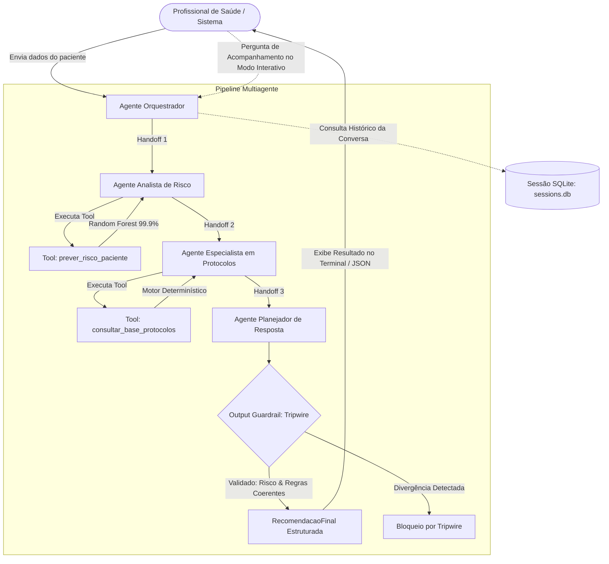

# Arquitetura Multiagente: Sistema Preditivo de Eventos Cardíacos
**Projeto CardioAI — Fase 6 (FIAP / Engenharia de Software & IA)**  
**Integrantes:** Jonas Luis da Silva (RM561465) e Edson Henrique Felix Batista (RM566321)  
**Framework:** OpenAI Agents SDK (`openai-agents`) | **Persistência:** SQLiteSession

---

## 1. Visão Geral da Arquitetura

O sistema multiagente da Fase 6 do **CardioAI** implementa uma arquitetura de colaboração sequencial com especialização funcional estrita. Em vez de utilizar um modelo de linguagem monolítico para adivinhar diagnósticos, a solução desacopla as responsabilidades em **4 agentes especializados**:

1. **Agente Orquestrador:** Ponto de entrada, recepção do caso, validação de dados e interface para dúvidas de acompanhamento (*follow-up*);
2. **Agente Analista de Risco:** Consulta o modelo preditivo supervisionado (*Random Forest*) via ferramenta dedicada;
3. **Agente Especialista em Protocolos:** Consulta a base determinística de diretrizes e protocolos hospitalares;
4. **Agente Planejador de Resposta:** Consolida os achados, planeja ações operacionais e gera saída estruturada sob supervisão de *Output Guardrail*.



---

## 2. Papéis dos Agentes, Handoffs e Compartilhamento de Estado

### Isolamento de Estado com `CardioContext`
O compartilhamento de informações entre os agentes **não utiliza estado global** (atendendo ao feedback da fase anterior). Cada paciente recebe uma instância isolada da dataclass `CardioContext`:
```python
@dataclass
class CardioContext:
    dados_paciente: dict[str, Any]
    resultado_risco: dict[str, Any] | None = None
    protocolos_acionados: list[dict[str, Any]] | None = None
```

### Detalhamento dos 4 Agentes
- **Agente Orquestrador:** Valida os dados de entrada (`DadosPaciente` via Pydantic). Quando iniciado para triagem, transfere o controle para o Analista de Risco através de `handoff(agente_analista_risco, on_handoff=...)`. Em mensagens subsequentes, utiliza a memória da `SQLiteSession` para explicar as decisões tomadas.
- **Agente Analista de Risco:** Não faz inferência matemática por conta própria. Invoca obrigatoriamente a ferramenta `@function_tool prever_risco_paciente`, que executa o classificador Random Forest em pipeline, salva o resultado em `ctx.context.resultado_risco` e transfere o fluxo para o Especialista em Protocolos.
- **Agente Especialista em Protocolos:** Invoca a ferramenta `@function_tool consultar_base_protocolos`, que aplica o motor de regras determinístico sobre as 10 variáveis do paciente e a classificação de risco, registrando os protocolos em `ctx.context.protocolos_acionados` e transferindo para o Planejador.
- **Agente Planejador de Resposta:** Atua como o sintetizador do hospital inteligente. Gera ações operacionais de gestão de leitos, contingência e remanejamento de insumos. Produz saída tipada conforme o esquema Pydantic `RecomendacaoFinal`.

---

## 3. Validação de Saída (Output Guardrail com Tripwire)

Para assegurar confiabilidade clínica, o Agente Planejador é monitorado por um `@output_guardrail` determinístico. O **tripwire** é imediatamente acionado (`OutputGuardrailTripwireTriggered`), interrompendo a entrega da mensagem caso ocorra qualquer uma das seguintes violações:
1. **Divergência de Probabilidade:** A probabilidade na recomendação difere daquela calculada pelo modelo de ML em mais de 0.01;
2. **Incoerência Categórica:** A classificação (BAIXO, MODERADO, ALTO) não corresponde aos limiares para o valor numérico de probabilidade;
3. **Protocolo Inexistente ou Alucinado:** O texto do protocolo não pertence à lista oficial de 10 protocolos do enunciado;
4. **Omissão de Protocolo Obrigatório:** Algum protocolo acionado pelo motor determinístico deixou de ser incluído na resposta final.

---

## 4. Persistência de Histórico de Mensagens com `SQLiteSession`

O sistema utiliza a classe `SQLiteSession` (`from agents.memory.sqlite_session import SQLiteSession`) conectada ao banco local `data/sessions.db` (ignorado no versionamento via `.gitignore`).
- Cada atendimento possui um `session_id` único;
- Permite que o profissional de saúde entre no modo interativo (`--interativo`) e faça perguntas contextuais como *"Por que o plano de contingência foi acionado?"*;
- O Agente Orquestrador consulta o histórico persistido e responde citando as variáveis específicas do caso (ex: *densidade_eventos = 7 > 6* e *carga_sistema = 92% > 85%*).

---

## 5. Exemplo Real de Execução (Paciente do Enunciado: `novo_caso.json`)

### Dados Clínicos de Entrada:
```json
{
  "idade_media": 62,
  "carga_sistema": 92,
  "tempo_espera": 75,
  "fc_media": 118,
  "spo2_media": 89,
  "pa_sistolica": 100,
  "temperatura": 37.5,
  "densidade_eventos": 7,
  "eventos_24h": 5,
  "disponibilidade_recursos": 25
}
```

### Saída Real de Execução no Terminal (`reports/execucoes/novo_caso.txt`):
```text
======================================================================
🏥 CARDIOAI - SISTEMA PREDITIVO MULTIAGENTE DE RISCO CARDÍACO
======================================================================
📁 Paciente: data/exemplos/novo_caso.json
🆔 Sessão SQLite: sessao_novo_caso_ccf3b9
🧠 Modelo LLM: gpt-4o-mini
======================================================================

🔄 [HANDOFF]: Agente Orquestrador ➔ Agente Analista de Risco

🔧 [TOOL] prever_risco_paciente executada com sucesso:
   - Probabilidade: 0.99
   - Classe Prevista: 1
   - Classificação: ALTO

🔄 [HANDOFF]: Agente Analista de Risco ➔ Agente Especialista em Protocolos

🔧 [TOOL] consultar_base_protocolos executada com sucesso:
   - Protocolos acionados: 4
     * Se carga do sistema > 85% → abrir unidades temporárias
     * Se disponibilidade_recursos < 30% → redistribuir insumos
     * Se densidade_eventos > 6 → ativar plano de contingência
     * Se risco sistêmico alto → ativar estado de emergência

🔄 [HANDOFF]: Agente Especialista em Protocolos ➔ Agente Planejador de Resposta

🛡️ [GUARDRAIL]: Saída do Planejador validada com sucesso! Sem violações de integridade.

======================================================================
RISCO PREVISTO: 0.99
CLASSIFICAÇÃO: ALTO

PROTOCOLOS SUGERIDOS:
- Se carga do sistema > 85% → abrir unidades temporárias
- Se disponibilidade_recursos < 30% → redistribuir insumos
- Se densidade_eventos > 6 → ativar plano de contingência
- Se risco sistêmico alto → ativar estado de emergência

AÇÕES OPERACIONAIS:
- Monitoramento contínuo dos sinais vitais do paciente em tempo real.
- Notificar a equipe médica sobre o alto risco cardiovascular identificado.
- Preparar a equipe para administração imediata de medicamentos cardiovasculares necessários.
- Estabelecer contato com unidades de terapia intensiva para potencial internação do paciente.

JUSTIFICATIVA:
Dada a alta probabilidade de 99% para risco cardiovascular, associada a uma classificação de Risco Alto, é fundamental ações imediatas de cuidado. A sobrecarga do sistema, com carga superior a 85%, indica uma necessidade de abrir unidades temporárias para melhor gerenciamento dos pacientes. Já a baixa disponibilidade de recursos (25%) requer redistribuição imediata de insumos para garantir suporte eficiente. A densidade de eventos, superior a 6, sugere que ativar o plano de contingência é necessário para manejo adequado. Conforme os protocolos, devemos ativar o estado de emergência devido ao risco sistêmico elevado, assegurando que todas as medidas apropriadas sejam implementadas para a segurança do paciente.

AVISO:
As informações coletadas são de natureza sensível e devem ser tratadas em conformidade com a legislação de proteção de dados e normas de ética médica.
======================================================================
```

---

## 6. Modo Interativo e Memória SQLite (`reports/execucoes/interativo_novo_caso.txt`)

- **Pergunta do Profissional de Saúde:** `"por que o plano de contingência foi acionado?"`
- **Resposta Real do Orquestrador (com instruções refinadas contra diagnósticos clínicos):**
  > *"O plano de contingência foi acionado devido a uma combinação de fatores que indicam uma sobrecarga crítica no sistema de atendimento. Esses fatores incluem:  
  > 1. **Carga do sistema acima de 85%**: A carga atual é de 92%, indicando operação acima da capacidade ideal.  
  > 2. **Disponibilidade de recursos abaixo de 30%**: Com apenas 25% dos recursos disponíveis, há risco significativo de sobrecarga.  
  > 3. **Densidade de eventos acima de 6**: Com densidade de 7, a situação é crítica, exigindo resposta rápida e estruturada.  
  > Essa soma de condições justifica a ativação do plano de contingência para garantir que os pacientes sejam atendidos com segurança e eficiência."*

---

## 7. Demonstração do Output Guardrail com Tripwire (`reports/execucoes/guardrail.txt`)

Ao injetar propositalmente no Planejador a instrução para forçar o protocolo `"Se SPO2 < 88% → iniciar suporte respiratório imediato"` para o paciente de teste (SpO2 = 89%), o guardrail capturou a tentativa de alucinação e acionou o tripwire:
```text
🚨 [TRIPWIRE DISPARADO NO GUARDRAIL]: Protocolo(s) indevido(s) ou não autorizado(s) pelas regras clínicas determinísticas: ['Se SPO2 < 88% → iniciar suporte respiratório imediato']
🚨 EXCEÇÃO CAPTURADA: OutputGuardrailTripwireTriggered — Guardrail OutputGuardrail triggered tripwire
```

---

## 8. Separação de Camadas: Modelo Preditivo vs. Motor de Regras

No teste do caso limítrofe ([`caso_moderado_risco.json`](../data/exemplos/caso_moderado_risco.json)), o Random Forest calculou probabilidade de **0.59 (MODERADO)**, porém nenhum protocolo determinístico foi disparado:
- O score prediz a criticidade e probabilidade de colapso/sobrecarga do cenário de forma contínua;
- O motor de regras apenas aciona ações quando gatilhos individuais estritos são atingidos (ex: carga > 85%, SpO2 < 88%).  
Essa dissociação demonstra que o sistema opera em camadas desacopladas de inteligência.

