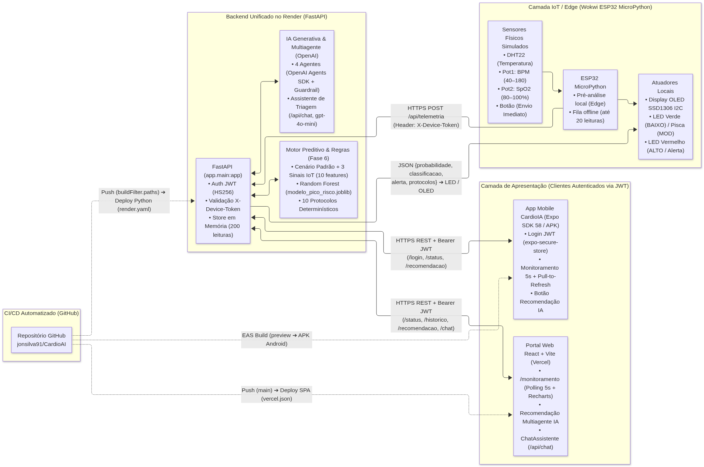
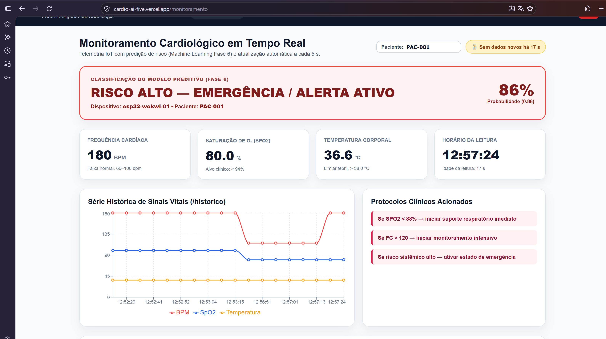
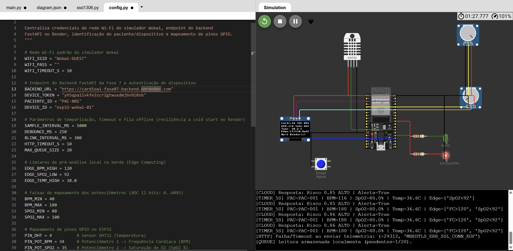
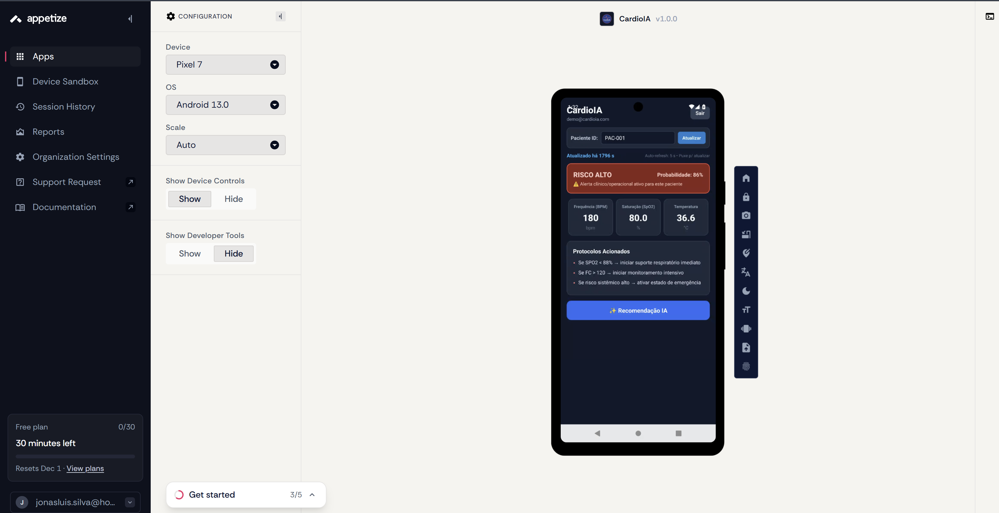
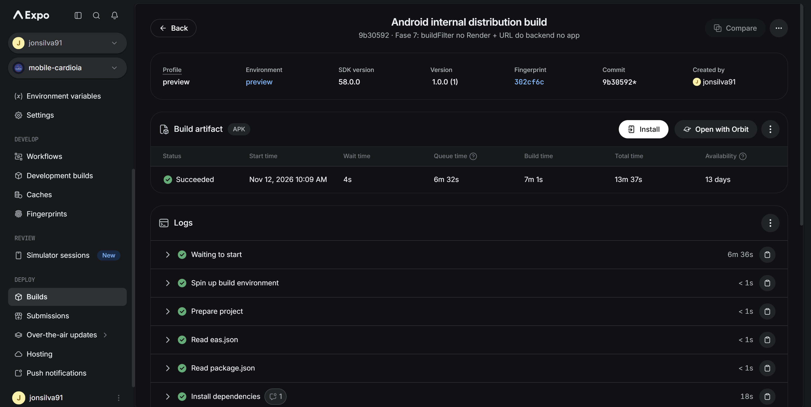
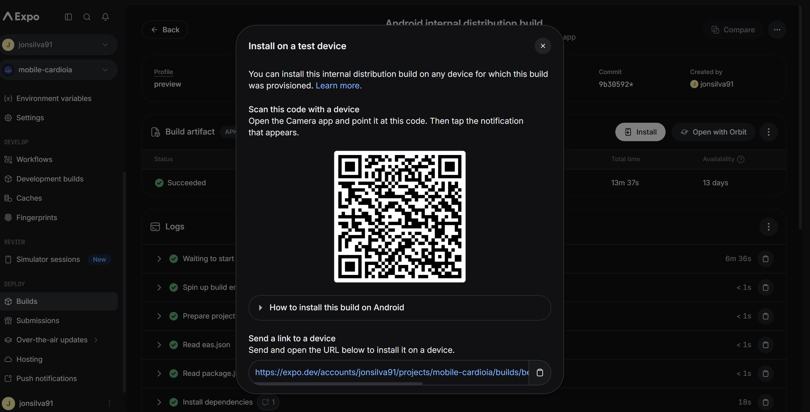
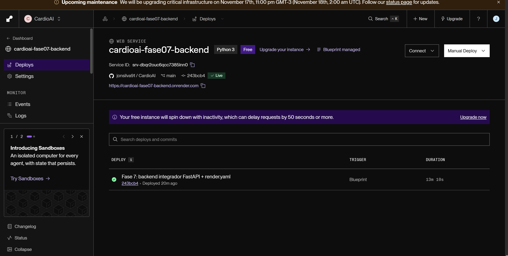
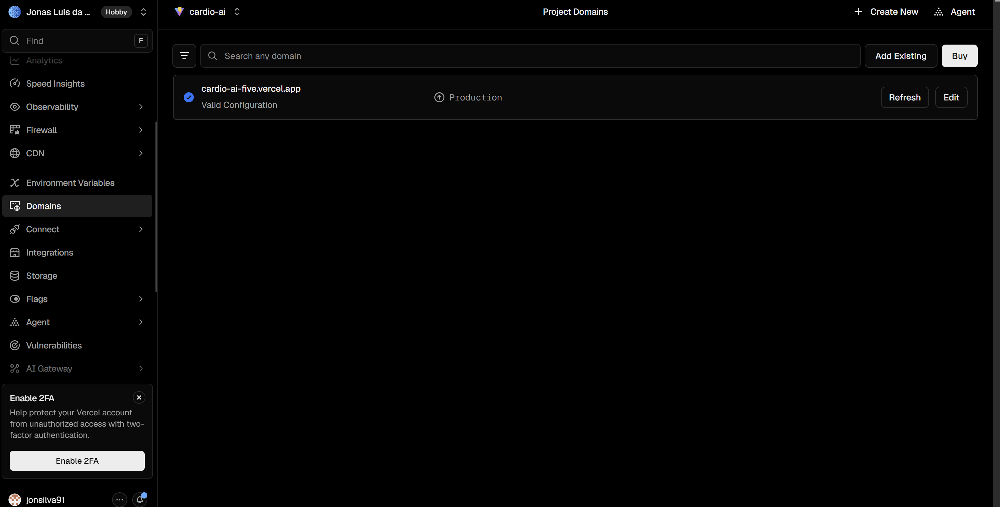

# Fase 7 — Plataforma Integrada CardioAI (IoT, Cloud, ML, Multiagente, Web e Mobile)

[](https://www.fiap.com.br/)

> Entrega final de consolidação da **Plataforma Integrada CardioAI**, unificando o nó de borda IoT em MicroPython (Wokwi ESP32), o Backend FastAPI em nuvem (Render), o Modelo Preditivo *Random Forest*, os Protocolos Clínicos e o Sistema Multiagente da Fase 6 (*OpenAI Agents SDK*), o Assistente Conversacional de Triagem, o Portal Web em React/Vite (Vercel) e o Aplicativo Mobile Android (APK via Expo EAS Build).

---

## 👨‍🎓 Integrantes do Grupo

- **Jonas Luis da Silva** — RM561465
- **Edson Henrique Felix Batista** — RM566321

---

## 🌐 Links Reais em Produção e Credenciais de Demonstração

| Componente | Ambiente / Plataforma | Link Público |
| :--- | :--- | :--- |
| **Portal Web (Produção)** | Vercel (React + Vite SPA) | [https://cardio-ai-five.vercel.app](https://cardio-ai-five.vercel.app) |
| **Backend API (Produção)** | Render (FastAPI Python) | [https://cardioai-fase07-backend.onrender.com](https://cardioai-fase07-backend.onrender.com) |
| **Documentação Swagger / OpenAPI** | Render (`/docs`) | [https://cardioai-fase07-backend.onrender.com/docs](https://cardioai-fase07-backend.onrender.com/docs) |
| **Healthcheck do Backend** | Render (`/health`) | [https://cardioai-fase07-backend.onrender.com/health](https://cardioai-fase07-backend.onrender.com/health) |
| **Build do APK Android** | Expo EAS Build (`preview`) | [https://expo.dev/accounts/jonsilva91/projects/mobile-cardioia/builds/be64508a-ebc2-4fb2-9ab3-93a89bb8b267](https://expo.dev/accounts/jonsilva91/projects/mobile-cardioia/builds/be64508a-ebc2-4fb2-9ab3-93a89bb8b267) |
| **Simulação IoT (ESP32 MicroPython)** | Wokwi (Projeto Público) | [https://wokwi.com/projects/480500031706588161](https://wokwi.com/projects/480500031706588161) |

### 🔑 Credenciais de Demonstração (Dados 100% Sintéticos)
- **E-mail:** `demo@cardioia.com`
- **Senha:** `CardioIA@2026`
- **ID do Paciente Padrão:** `PAC-001`

---

## 🏛️ Arquitetura da Plataforma Integrada



- **Relatório Técnico Completo (Markdown):** [docs/relatorio_tecnico_fase07.md](docs/relatorio_tecnico_fase07.md)
- **Relatório Técnico Completo (PDF — 3 páginas):** [docs/relatorio_tecnico_fase07.pdf](docs/relatorio_tecnico_fase07.pdf)
- **Evidência dos Testes Locais e Pytest:** [docs/evidencias/backend_local.txt](docs/evidencias/backend_local.txt)

---

## 📸 Evidências Visuais Reais (`docs/prints/`)

### 1. Monitoramento no Portal Web (Vercel — `/monitoramento`)


### 2. Simulação IoT ESP32 em MicroPython (Wokwi)


### 3. Aplicativo Android Validado no Emulador Pixel 7 / Android 13 (Appetize.io)
> **Nota:** A validação funcional do APK foi executada no emulador **Android Pixel 7 (Android 13) via Appetize.io** (pois o integrante utiliza iOS), além da validação direta do artefato gerado no Expo EAS Build.



### 4. Build do APK e QR Code no Expo EAS
| Build Concluído no EAS (`eas_build.png`) | QR Code de Instalação (`eas_qrcode.png`) |
| :---: | :---: |
|  |  |

### 5. Deploy Contínuo no Render e na Vercel
| Backend FastAPI no Render (`render_deploy.png`) | Portal React/Vite na Vercel (`vercel_deploy.png`) |
| :---: | :---: |
|  |  |

---

## 📲 Como Instalar e Testar o APK Android

1. **Via Link Direto / QR Code do Expo EAS:**
   - Acesse [https://expo.dev/accounts/jonsilva91/projects/mobile-cardioia/builds/be64508a-ebc2-4fb2-9ab3-93a89bb8b267](https://expo.dev/accounts/jonsilva91/projects/mobile-cardioia/builds/be64508a-ebc2-4fb2-9ab3-93a89bb8b267) em um dispositivo Android ou escaneie o QR Code (`docs/prints/eas_qrcode.png`) para baixar e instalar o `.apk`.
2. **Via GitHub Releases:**
   - Baixe diretamente o arquivo `.apk` na Release oficial do repositório: `https://github.com/jonsilva91/CardioAI/releases/tag/v1.0-fase7`.
3. **Via Emulador Online (Appetize.io):**
   - Faça upload do arquivo `.apk` do EAS em [https://appetize.io](https://appetize.io), selecione **Pixel 7 / Android 13** e autentique com `demo@cardioia.com` / `CardioIA@2026`.

---

## 💻 Como Executar Localmente

### 1. Backend FastAPI (`phases/fase07_plataforma_integrada/backend/`)

```bash
# A partir da raiz do repositório
pip install -r phases/fase07_plataforma_integrada/backend/requirements.txt

# Copie o arquivo de exemplo e preencha as variáveis no .env local
cp phases/fase07_plataforma_integrada/backend/.env.example phases/fase07_plataforma_integrada/backend/.env

# Execute a suíte de testes automatizados (10 testes pytest, sem chamadas à OpenAI)
pytest phases/fase07_plataforma_integrada/backend/tests -v

# Inicie o servidor FastAPI
uvicorn app.main:app --app-dir phases/fase07_plataforma_integrada/backend --host 0.0.0.0 --port 8000 --reload
```

### 2. Portal Web React + Vite (`apps/portal-cardioia/`)

```bash
cd apps/portal-cardioia
cp .env.example .env
npm install
npm run lint
npm run build
npm run dev
```

### 3. Aplicativo Mobile Expo (`apps/mobile-cardioia/`)

```bash
cd apps/mobile-cardioia
cp .env.example .env
npm install
npx expo-doctor
npx expo start
```

### 4. Nó IoT MicroPython no Wokwi (`phases/fase07_plataforma_integrada/iot/`)

1. Acesse o projeto público no Wokwi: [https://wokwi.com/projects/480500031706588161](https://wokwi.com/projects/480500031706588161) (ou importe `iot/diagram.json`, `iot/main.py`, `iot/config.py` e `iot/ssd1306.py`).
2. Em `config.py`, defina `DEVICE_TOKEN` com o mesmo valor configurado no backend e mantenha `PACIENTE_ID = "PAC-001"`.
3. Inicie a simulação, ajuste os potenciômetros de **BPM (40–180)** e **SpO2 (80–100%)** ou a temperatura no **DHT22** e pressione o botão **Enviar Agora** para envio imediato.
4. Consulte os detalhes completos e a tabela C++ ➔ MicroPython em [iot/README.md](iot/README.md).

---

## 🔐 Variáveis de Ambiente (Apenas Nomes — Sem Segredos no Repositório)

### Backend (`phases/fase07_plataforma_integrada/backend/.env.example` / Render)
- `OPENAI_API_KEY` — Chave da API OpenAI para o pipeline multiagente (`/recomendacao`) e assistente (`/api/chat`)
- `OPENAI_MODEL` — Modelo LLM utilizado (`gpt-4o-mini`)
- `JWT_SECRET` — Segredo de assinatura e verificação dos tokens JWT (`HS256`, obrigatório)
- `DEVICE_TOKEN` — Token esperado no header `X-Device-Token` em `POST /api/telemetria` (obrigatório)
- `DEMO_EMAIL` — E-mail autorizado para login em `POST /api/auth/login` (obrigatório)
- `DEMO_PASSWORD` — Senha autorizada para login em `POST /api/auth/login` (obrigatório)
- `ALLOWED_ORIGINS` — Lista de origens permitidas no CORS separadas por vírgula
- `APP_ENV` — Ambiente de execução (`dev` permite geração efêmera de `JWT_SECRET` em desenvolvimento local)

### Portal Web (`apps/portal-cardioia/.env.example` / Vercel)
- `VITE_API_URL` — URL base pública do backend FastAPI

### App Mobile (`apps/mobile-cardioia/eas.json` / `.env.example`)
- `EXPO_PUBLIC_API_URL` — URL base pública do backend FastAPI embutida nos perfis do EAS Build

---

## 📦 Arquivos Obrigatórios de Deploy e Configuração

- **[render.yaml](../../render.yaml)** (na raiz do repositório): Web Service Python (plano `free`), `healthCheckPath: /health`, variáveis com `sync: false` e `buildFilter.paths` monitorando apenas `phases/fase07_plataforma_integrada/backend/**`, `phases/fase06_preditivo_multiagente/src/**`, `phases/fase06_preditivo_multiagente/models/**` e `render.yaml`.
- **[apps/portal-cardioia/vercel.json](../../apps/portal-cardioia/vercel.json)**: Configuração de rewrite SPA (`/(.*) -> /index.html`).
- **[apps/mobile-cardioia/app.json](../../apps/mobile-cardioia/app.json)**: Configurado com `name: "CardioIA"`, `android.package: "br.com.fiap.cardioia"` (domínio invertido) e `android.versionCode: 1`.
- **[apps/mobile-cardioia/eas.json](../../apps/mobile-cardioia/eas.json)**: Perfis `development`, `preview` (`android.buildType: "apk"` + `EXPO_PUBLIC_API_URL`) e `production`.

---

## 🎥 Vídeo de Demonstração da Fase 7

- **Link do Vídeo (YouTube Não Listado):** [https://youtu.be/e7b1ICpbym0](https://youtu.be/e7b1ICpbym0)

